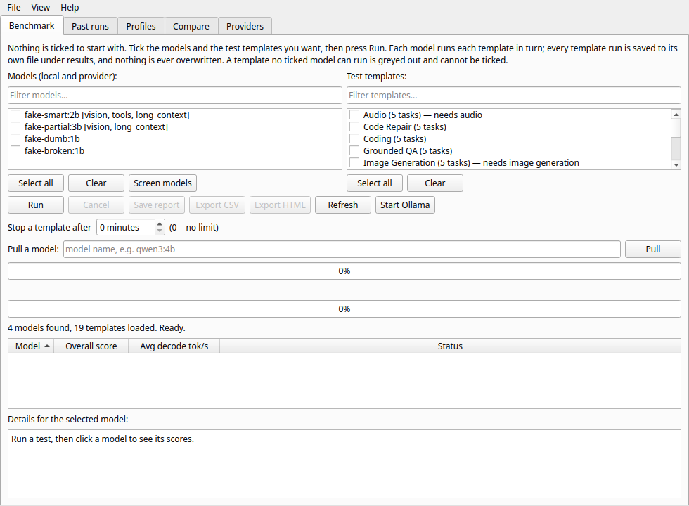

# OLLAMA SYSTEM TEST v13

A desktop window that tests your Ollama models on this PC — and cloud
providers' models too — with the same test templates, the same scoring,
and the same profiles. It lists the models you have pulled, plus the
models on any provider you add, runs each one through test templates,
scores them, and builds a profile for each model — its strengths,
weaknesses, and a plain-language verdict from the numbers.

v13 is a run release, no new templates: pressing Run shows a preview
first — what will run, how many steps, an upper-bound time estimate,
and the provider cost when there is one — with Run and Adjust. While
a run goes, a line under the progress bar shows the current step, the
step count, the elapsed time, and a remaining-time estimate from the
real rate so far, and a small status chip says Ready, Running, Done,
Stopped, or Ollama stopped. When a run completes, one headline names
the best model, its score and speed, and the run's totals. The results
table gains two columns — average time to first token and average
prompt speed — and the detail view now shows what each model actually
wrote under each task.

v12 is a layout release, no new templates: the one crowded Benchmark
tab is now three tabs, one job each — Run setup (pick models and
templates, press Run), Run (progress, results table, details), and
Models (installed models, pull a new one, Refresh, Start Ollama).
The status line sits under the tabs so it is visible everywhere, and
the app switches to the Run tab when a run starts. Help now has a
How to Use index — the full manual in its own window. A first run
gets a setup checklist at the top of Run setup (Ollama running, a
model pulled, first run done); it goes away once those are done and
never comes back. And the app opens once only: clicking the icon
again brings the running copy forward instead of starting a second
one.

v9 is a polish release, no new templates: filter boxes above the
model and template lists on the Run setup tab, so you can type to
find one instead of scrolling (ticked items keep their ticks while
filtered, and the grey-outs keep working); a dark theme on the View
menu, remembered across restarts; the README's prompt count fixed
to 103 for a full run; and the app creates the `images` and `audio`
folders on its first launch, so there is somewhere to put your own
test image or recording.

v8 is a management release, no new templates: a run can be deleted
from the Past runs tab (its file and any images or audio it saved go
with it, and the model's profile rebuilds from the runs that are
left), and the tab shows how much disk the results store uses;
pressing Run with provider models ticked shows the estimated cost
first and asks to confirm when it is over $1.00 (or when no prices
are saved, so the cost is unknown); an opt-in per-template time
budget stops a template's jobs at the limit with a plain "time budget
reached" status, default off; and the current results export to CSV
and HTML, with a Compare tab putting two models' per-template scores
side by side.

v7 is a usability release, no new templates: you can run a benchmark
with no window at all (`--headless`, for scripts and cron — see below);
the window shows its version in the title bar ("OLLAMA SYSTEM TEST v7")
and has an icon; the window opens where you left it (size and position
survive a restart); there are keyboard shortcuts (Ctrl+R Run, Ctrl+S
Save report, Esc Cancel) and a menu bar (File, Help, About); and the
app ships desktop files — double-click Install-OST to install it, then
open OST from your app menu.

v6 is a fix release, no new templates: a missing test image or audio
clip now records its tasks as "not run" instead of failing them, so a
run never scores 0% for a missing file; `providers.json` (which holds
your API keys) is written atomically and is owner-only from the first
byte; the verification suite lives in the repo under `tests/` and runs
on every push; launching without PySide6 prints a plain message telling
you to run `install.sh` instead of a traceback; `install.sh` checks the
install worked before saying it is done; and PySide6-Essentials is
pinned to 6.12.0, the version the suite was verified against.

v5 adds capability screening: the app checks what each model can
actually do (vision, tool calling, long context, image generation,
audio) and greys out the templates no ticked model can run, so you
never waste a run on a test a model cannot take. It also adds 13 new
test templates — vision, image generation, tool calling, long context,
multi-turn chat, code repair, planning, grounded answers, refusal
behaviour, summarisation, strict structured output, role following,
and audio — and the Speed template now measures tokens per second at
1K, 8K, and 32K context.

## Install (one time)

Open a terminal in this folder, then type:

    sh install.sh

It creates a private folder (.venv) for the one package the app needs
(PySide6-Essentials, pinned to 6.12.0 in `requirements.txt`). If it
says python3-venv is missing, type this first:

    sudo apt install python3-venv

Then run `sh install.sh` again. install.sh checks the install worked
(PySide6 imports, the app compiles) before it says it is done — if
the check fails, it says so instead of reporting success. It also puts
OST in your app menu, with its icon, so you can open it without a
terminal. (If that step has a problem it says so and the app still
runs from `sh run.sh`.)

If you got the app by cloning the repo rather than from the Release
zip, make the scripts runnable first — the exec bits do not survive
a clone:

    chmod +x install.sh run.sh

(The Release zip already carries them, so a zip install needs no
extra step.)

You can also install by double-clicking Install-OST in the folder —
it runs the same installer in a terminal window.

## Start it

    sh run.sh

Or open OST from your app menu (install.sh puts it there). The window
remembers its size and position: it opens where you left it. It opens
light; View > Dark mode switches it to a dark theme, and the choice is
remembered next time.

## How to use it

1. On the Run setup tab, tick the models you want to test. Nothing is ticked to start with —
   tick only what you want. Select all is there if you want everything.
   Local Ollama models are listed by name; provider models are listed
   as "provider / model", for example `openai / gpt-4o-mini`. Models
   that can do more than plain text show it in brackets, for example
   `qwen3-vl:2b-instruct [vision]`. The filter box above the list
   narrows it as you type — filtering by "vision" finds every vision
   model — and ticked models keep their ticks while filtered.
2. Tick the test templates you want to run. Same rule: nothing is
   ticked to start with. Templates no ticked model can run are greyed
   out and cannot be ticked — tick a model that can run them and they
   light up again. With nothing ticked, everything shows enabled.
   The filter box above the list narrows it as you type, and the
   grey-outs keep working while a filter is on.
3. Press Run. A preview shows first: what the run will do — models,
   templates, step count, an upper-bound time estimate, and the
   provider cost when there is one (from the prices you saved and the
   tokens the chosen templates will use). Press Run to go ahead, or
   Adjust to close the preview and change the ticks. The time estimate
   uses each model's measured speed from its newest past run, or
   8 tok/s for a model that has never run here, plus 10 s per model
   for loading, times a safety margin; it says "at most about" because
   that is what it is. The cost estimate covers text tokens only and
   is an upper bound: a model usually stops well short of the most it
   is asked for, so the real bill is usually lower. Once the run
   starts, the app switches to the Run tab and each model runs each
   template in turn, one at a time.
   A full run (all templates, all models) takes a while — each model
   answers 103 prompts (90 scored tasks, plus the extra turns in the
   multi-turn and role-following templates, plus 3 speed runs), and
   the 32K speed run takes minutes on a CPU by design — so start with
   one model or one template to get a feel for the speed, then run
   the rest. While it goes, a line under the progress bar shows the
   current step, the step count, the elapsed time, and a remaining-time
   estimate from the real rate so far, and a small status chip says
   Running; Cancel stays enabled through the whole run. When it
   finishes, one headline names the best model, its score and speed,
   and the run's totals. The "Stop a template after __
   minutes" box is an opt-in time budget per template (0 = no limit,
   the default): when set and a template's jobs run past it, that
   template's jobs stop with "time budget reached" and the run
   carries on with the next template.
4. On the Run tab, the table shows, for each model: overall score, average decode speed,
   average time to first token, average prompt speed, and status. Click a model to see its per-template scores, which
   tasks passed or failed, what the model actually wrote under each
   task, and — for provider models — the tokens used
   and the estimated cost. Templates a model was not eligible for show
   as "not eligible for this model", never as a failure.
5. Press Save report to keep a summary of the session. It writes two
   files into the `results` folder next to the app: a plain text report
   and a JSON file. Export CSV and Export HTML save the same current
   results — model, overall score, speed, status, and per-template
   scores — as a spreadsheet file or a web page, wherever you choose.
6. The Past runs tab lets you browse every run you have ever done,
   grouped by model and by system. It also shows how much disk the
   results store uses ("Results use 12.3 MB"). To remove a run, pick
   it and press Delete run: its file and any images or audio it saved
   are removed, and the model's profile rebuilds from the runs that
   are left. Deleting asks to confirm first, and it is disabled while
   a run is in progress.
7. The Profiles tab shows each model's profile: latest and best scores,
   strengths and weaknesses, and a verdict written from its numbers.
   Profiles render as formatted text — headings, bold, lists — not raw
   markdown. Profiles rebuild themselves after every run. Press
   Regenerate to rebuild one from the run files on disk at any time.
8. The Compare tab puts two models side by side: pick two models and
   it shows their latest score on each template they ran, plus their
   overall score and speed. Picking the same model twice shows a
   message instead of a duplicated table.
9. Shortcuts: Ctrl+R runs, Ctrl+S saves the report, Esc cancels a
   run. The File menu has Save report and Quit; Help has How to Use,
   the full manual in its own window; About, which shows the version
   (also in the title bar); and Debug report, which saves a scrubbed
   copy of the app's log (see below).

## Run it without the window (headless)

For scripts and cron, the same benchmark runs with no window:

    .venv/bin/python ollama_system_test.py --headless --models qwen3:0.6b --templates coding,math

`--models` takes comma-separated model names; a provider model is
written "provider / model-id", for example
`--models "openai / gpt-4o-mini"`. `--templates` takes comma-separated
template ids. It writes the same run files under `results/` (and
rebuilds the profiles), prints a plain summary, and exits 0 when the
run finished or 1 when it did not (unknown model or template, Ollama
not running, or the run stopped). `--help` lists every flag.

## Capability screening

When the model list loads, the app asks Ollama what each model can do
and remembers the answer in `capabilities.json` next to the app, so
it does not have to ask every time. A model's capabilities show in
brackets after its name in the list. If you pull a new version of a
model, or the list looks wrong, press Screen models: it throws the
saved answers away and asks Ollama again for every model.

Provider models do not report capabilities to the app, so you tick
them yourself on the Providers tab when you add a model: Text, Vision,
Tools, Image generation, Audio, and Long context. A model starts
text-only; tick what it can do. Clicking a model in the list loads it
into the form so you can change its ticks later — press Update model,
then Save provider.

A template is enabled only when at least one ticked model can run it.
If a model cannot run a template at all, that pair is skipped in the
run and recorded as "not eligible" — it never counts as a failure and
never drags the model's score down.

## If Ollama is not running

The app checks before every run that touches a local model. If Ollama
is down, the run will not start — press Start Ollama and the app will
start it for you, wait for it to answer (up to 30 seconds), then refresh
the model list. If it cannot start Ollama, it will say so: run
`ollama serve` in a terminal to see the error.

If Ollama stops answering in the middle of a run, the run stops right
there — it will not plough on through the rest of the models. Start
Ollama again, press Refresh, and Run again.

Provider-only runs do not need Ollama at all: if you tick only provider
models, the run goes ahead even while Ollama is down.

## Providers

The Providers tab adds cloud providers — OpenAI, OpenRouter, Groq,
Together, DeepSeek, xAI, Mistral, or a local OpenAI-compatible server
such as LM Studio. Any provider with an OpenAI-compatible API works:
the app talks to `{base URL}/chat/completions` and
`{base URL}/models`.

To add one: press New provider, fill in the name (your own label, e.g.
`openai`), the base URL (e.g. `https://api.openai.com/v1`), and the
API key, then press Test connection to check it answers (that costs
no tokens). Add the models you want to test by their id (e.g.
`gpt-4o-mini`), with a display name and prices per 1M tokens if you
want cost shown, and tick the capabilities the model has (see
Capability screening above). Press Save provider when you are done —
the models appear in the Run setup list, unticked like everything else.

Your API keys live in `providers.json` next to the app. That file
holds your keys: never share it, never upload it, never send it to
anyone. The app never writes a key anywhere else — not into a run
file, a report, a profile, or the status line — and the key is never
shown on screen. The file is written atomically and is readable only
by you from the first byte, so a crash mid-save cannot lose your keys
or leave them readable by anyone else. It is also in `.gitignore`,
so a stray `git add .` cannot commit it. When you edit a provider,
the key field is left empty on purpose: leave it empty to keep the
saved key, or type a new one to replace it.

Provider tests cost real API money. The details view shows the tokens
each model used (prompt and completion, including the warmup call)
and, when you set prices for the model, the estimated cost of the run.
No prices set means tokens only — the app never invents a cost. Before
a run with provider models starts, the app shows the estimated cost
for the models and templates you ticked: it counts the tokens the run
will send (the prompts, plus the exact context lengths for the
long-context and speed tests) and the most each call can answer, and
prices them at the rates you saved. When the estimate is over $1.00,
or when no prices are saved for a ticked provider model, the run asks
you to confirm before it starts; under $1.00 it starts straight away.
Run files record the tokens and the prices used, so the cost stays
attached to the run even if prices change later. Image generation
and audio calls are not token-counted by the app: those run files
record what was returned, not a cost, and the pre-run estimate does
not cover them either.

If a provider is down or a key is wrong, those models fail plainly
("provider X did not answer" / "provider X rejected the key") and the
run carries on with the rest — a provider outage never stops your
local Ollama tests. A single dropped connection is retried once; a
rejected key is never retried.

The Pull a model box is Ollama-only: provider models are added by
typing their id on the Providers tab, not pulled.

## Pull a model from the app

On the Models tab, type a model name in the "Pull a model" box (for example `qwen3:4b`)
and press Pull. The download runs in the background with a live
progress bar and a status line showing what is downloading and how many
megabytes are in so far. When it finishes, the new model appears in the
list — unticked, like everything else.

Pulls go to Ollama's own models folder. If you want models stored
somewhere else, that is Ollama's own setting: set the OLLAMA_MODELS
environment variable before starting Ollama.

## The test templates

- Speed: tokens per second at 1K, 8K, and 32K context, no scoring.
  The 32K run takes minutes on a CPU — that is the test, not a hang.
- Coding: write Python functions. Each answer is actually run against
  test cases, so a function only passes if it works.
- Math: word problems with known answers.
- Reasoning: short logic puzzles.
- Instruction: follow the format asked for (JSON, exact line counts,
  word limits).
- Knowledge: factual questions.
- Vision: describe, count, and read text in the bundled test images.
  Needs a vision model.
- Image Generation: ask a provider model to draw a picture. Passes
  when a real image comes back; the picture is saved into the run
  folder so you can judge it with your own eyes. The app never scores
  image quality — only you can say if the picture is any good.
  Provider only.
- Tool Calling: pick the right tool and the right arguments, including
  one task where no tool is needed at all. Needs a tools model.
- Long Context: find a code hidden in a long document (1K, 8K, and
  32K tokens). Needs a long-context model.
- Multi-turn: follow-ups across turns — remembering something said
  earlier, and correcting its own mistake.
- Code Repair: fix broken code from its error message. The fixed code
  is run, so it only passes if it works.
- Planning: lay out the steps for a job, in a sane order.
- Grounded QA: answer only from a passage. Some questions ask about
  things that are not in the passage at all — the right answer there
  is "not stated".
- Refusal: benign-but-tricky prompts (a bank-robbery story, a card
  trick, a spy scene). A model passes by answering, not by refusing.
- Summarisation: keep the key facts and hold the length limit.
- Structured Output: answer with valid JSON matching a schema, first
  try, no wrapper and no code fences.
- Role Following: stay in character across two turns, from a
  system-prompt role.
- Audio: transcription (check the words) and speech generation
  (check audio comes back). The speech clips are saved into the run
  folder so you can listen. Provider only.

Templates are JSON files in the `templates` folder. You can add your own:
copy one, change the id, name, and tasks, and press Refresh. A broken
template file is skipped with a warning, it never crashes the app. A
template can name a `capability` (vision, tools, image_generation,
audio, long_context) — only models with that capability can run it.

The vision test images live in the `images` folder (a shapes picture
and a shop-sign picture, both with known content). The audio test
clips live in the `audio` folder — real spoken clips: "hello world",
"one two three", and a weather sentence with the word "sunny" in it.
They match the three transcribe tasks, so a working transcription
provider should pass all three. You can still drop your own recording
into that folder and point a task at it.
The app creates both folders on its first launch, so they are there
waiting when you want to add your own image or clip.
If a test image or clip is missing, the tasks that need it are
recorded as "not run" — never as failures — and the template shows
"not run" instead of a score. The app warns about the missing file
when the templates load.

## Where results live

Every template run is saved to its own file as soon as it finishes:

    results/<model>/<system>/<time>-<template>.json

The system folder comes from your machine (CPU, RAM, OS), so when you
upgrade your PC one day, the new results go in a new folder and the old
ones stay untouched. Run files are never overwritten or edited. If two
runs ever land in the same second, the second one gets -2 on the name.

Each run file records the provider (`ollama` for local models, the
provider name otherwise), the model id, and — for provider runs — the
tokens used and the estimated cost. Provider models get their own
result folders, named after the "provider / model" label.

Generated images and speech clips are saved next to their run file,
in a folder named after it:

    results/<model>/<system>/<time>-image_generation-images/
    results/<model>/<system>/<time>-audio-audio/

Each run file lists the media files it saved, so the picture or clip
stays attached to the run that produced it. Like run files, media
folders are never overwritten.

Each model also gets a profile, rebuilt from all of its run files:

    results/<model>/PROFILE.md

The profile is a living summary — latest and best scores per template,
average speed, strengths (templates at 80% or better), weaknesses
(templates under 50%), and a short verdict written from the numbers.
For provider models it also totals the tokens used and the estimated
cost across template runs. It changes as you test more; the run files
underneath never do. Deleting a run from the Past runs tab removes
that run's file and its media folder, and the profile rebuilds from
the runs that are left — nothing else is touched.

## What the numbers mean

- Overall score: the average of the template scores, as a percent.
  A template score is the share of its tasks the model passed.
  Templates a model was not eligible for are left out entirely.
- Decode speed: how fast the model writes its answer, in tokens per
  second. Higher is faster. For provider models it is measured from
  the streamed answer and the token counts the provider reports; a
  provider that reports no usage shows no speed.
- First token: how long until the first word appears (saved in each
  run file, per task).
- Size in RAM: how much memory the model uses while loaded (local
  Ollama models only).
- Tokens: prompt and completion tokens the provider reports for a run.
  The model total includes the warmup call; template lines and profiles
  count template runs only.
- Estimated cost: tokens times the prices you set for the model, in
  dollars. Shown only when both prices are set.

## A note on the coding tests

For coding and code-repair tasks, the code the model writes is run on
your machine in a separate process, with a 10-second limit per test
case, to check it actually works. It runs as you, the same as anything
else you run. These are your own models on your own machine.

## If something goes wrong

- "Ollama is not running": press Start Ollama in the app, or start
  Ollama yourself, then press Refresh.
- "could not reach Ollama. Start it, then press Refresh": Ollama
  stopped answering. Start it again, press Refresh, and Run again.
- "provider X did not answer": the provider could not be reached.
  Check the base URL on the Providers tab, or try Test connection.
- "provider X rejected the key": the API key is wrong or revoked.
  Paste a fresh key on the Providers tab and press Save provider.
- A model row says "failed": that model could not run. The test
  carries on with the rest. Try that model on its own with
  `ollama run <name>` (local) or Test connection (provider) to see
  the error.
- A task says "failed": that task did not pass. Click the model to see
  why in the details.
- A task says "not run": the test image or audio clip that task needs
  is missing from the `images` or `audio` folder. Put the file back
  (or re-download the Release zip, which carries them) and run again.
  A "not run" task is not the model's fault and never counts toward
  its score.
- A template says "time budget reached": the per-template time budget
  (the "Stop a template after __ minutes" box) ran out before that
  template's jobs finished. The jobs that ran still count toward the
  score; the ones that did not are not failures. Raise the budget —
  or leave it at 0 for no limit — and run again.
- A template shows "not eligible for this model": the model cannot run
  that test (no vision, no tools, and so on). It is not a failure.
  Tick a model that has the capability to run it.
- Press Cancel any time to stop the run. Results so far stay in the table,
  and every finished template run is already saved.
- Debug report: Help > Debug report saves a scrubbed report of the
  app's recent log to the `logs` folder next to the app (one log file
  per day, kept for 30 days). It holds the app's own log only — no
  API keys and no model answers — so it is safe to send to someone
  helping you. If the app crashes, it writes a crash report to the
  same folder before it closes.

## Running the tests

The verification suite lives in `tests/` and runs against fake Ollama
and fake provider servers, so it needs no Ollama, no models, and no
real provider account. From the repo root, with the app installed:

    QT_QPA_PLATFORM=offscreen .venv/bin/python tests/run_tests.py

It opens real windows offscreen, runs full benchmark runs against the
fakes, and prints PASS/FAIL per check — exit code 0 means every check
passed. It takes about 8 minutes. The same suite runs on every push
via GitHub Actions (`.github/workflows/test.yml`).
